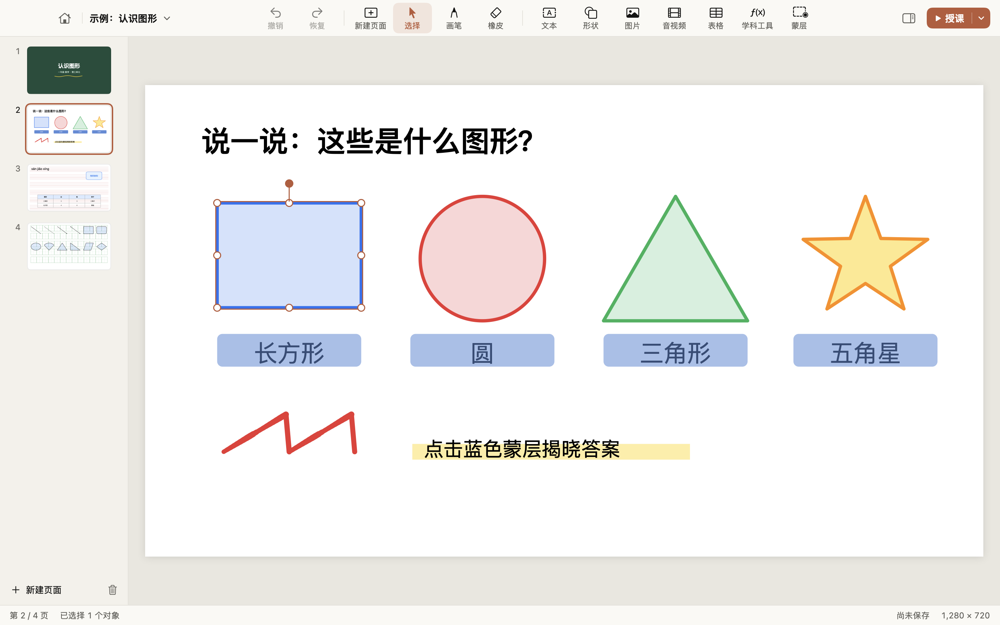
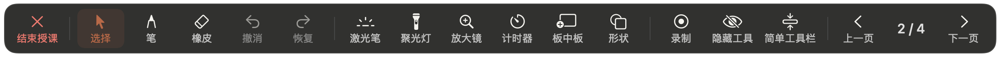

# 录课 Lesson Recorder

用笔在课件上写字讲课。适用于 Apple 芯片 Mac 的原生课堂白板（原名录课、XiwoBoard），界面和工作流程参照常见的教学白板软件（如 EasiNote / 希沃白板）：
备课时编辑课件，上课时全屏授课、板书、录屏讲课。SwiftUI + AppKit 编写，arm64 原生运行，不依赖 Electron。



授课工具栏：



## 主要功能

- **编辑**：页面缩略图、硬笔（带笔锋）/毛笔/荧光笔（书写防抖）、点擦/笔画擦、39 种形状、文本、表格、图片、音视频、组合与对齐、蒙层、克隆、超链接、书写格背景、撤销恢复。
- **授课**：全屏、底部工具栏（普通/简单）、翻页动画、激光笔、聚光灯、放大镜、计时器、板中板、页面列表。
- **录屏讲课**：ScreenCaptureKit 录制屏幕 + 麦克风（可选电脑声音），输出 MP4 到「影片 › 录课」；
  可以暂停和继续，暂停的时间不会录进视频。
  讲课时可一键隐藏全部工具只露出课件；录制时开启「只录课件」，工具栏、计时器等面板不会出现在视频里，老师自己仍能看到和使用。
- **文件**：原生 `.xwb` 格式；可打开和导出 `.enbx` 课件（常见元素）；导出 PDF 和图片。

完整清单和实现状态见 [docs/FEATURES.md](docs/FEATURES.md)。

## 下载安装

到 [Releases](https://github.com/haozhanghz/xiwo-board/releases/latest) 下载 `XiwoBoard-<版本>-arm64.zip`，解压后把 `XiwoBoard.app` 拖进「应用程序」（文件名沿用旧名，访达和程序坞里显示为「录课」）。

应用没有经过 Apple 公证，第一次打开会被系统拦下。可以在「系统设置 › 隐私与安全性」底部点「仍要打开」，
或者在终端运行 `xattr -cr /Applications/XiwoBoard.app`。需要 Apple 芯片和 macOS 15 及以上。

以后的新版本可以在应用里更新：菜单「录课 › 检查更新…」或首页左下角的「检查更新」。

## 构建

需要 macOS 15 及以上、Xcode 16 及以上（在 Xcode 27 / macOS 27 上验证）。

```bash
./scripts/build-app.sh          # 生成 build/XiwoBoard.app（arm64；本地构建是 ad-hoc 签名，发布包用项目证书，见 docs/SIGNING.md）
open build/XiwoBoard.app
swift test                      # 核心库单元测试
build/XiwoBoard.app/Contents/MacOS/XiwoBoard --ink-bench   # 在屏幕外模拟写字，打印每次移动和抬笔占用主线程的时间
build/XiwoBoard.app/Contents/MacOS/XiwoBoard --ink-latency # 全屏模拟 240 Hz 数位板写字约半分钟，打印每个笔点从事件到上屏的延迟
```

每次推送和 PR，GitHub Actions 都会在 Apple 芯片的 macOS 机器上编译、测试并打包。
`Info.plist` 里的版本号第一次合进 `main` 时，会自动发布 `v<版本号>` 的 Release（推送同名标签也可以），
发布说明取自 `docs/releases/v<版本号>.md`。所以发新版只需要改版本号、写好发布说明，再合进 `main`。

第一次录屏时，系统会请求「录屏与系统录音」和麦克风权限；授权后需要重新打开应用。
发布包用项目自己的证书签名，所以从 0.1.9 起，更新后这些权限会保留。

## 目录

```
Sources/XiwoCore      数据模型、形状几何、路径解析、ZIP、.xwb/.enbx 读写、Core Graphics 渲染
Sources/XiwoBoard     应用：首页、编辑器、画布、授课、录屏
Tests/XiwoCoreTests   单元测试
docs/FEATURES.md      功能与界面清单、.enbx 格式说明
```

## 说明

本项目为独立的净室实现，用于学习与互操作：功能范围参考了对 EasiNote Mac 版的静态分析（见 FEATURES.md），
但没有包含或改写其任何代码、图片、字体或其他受版权保护的资源。「希沃」「EasiNote」是其各自所有者的商标，本项目与其无关。
